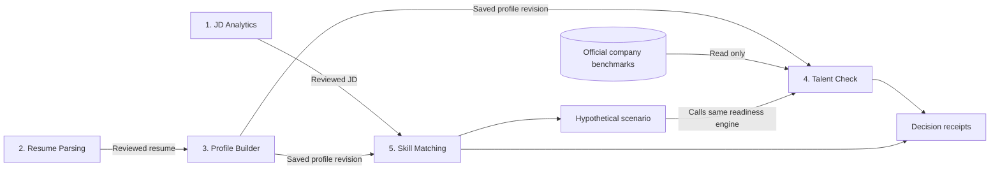

# RADIX Talent Match — complete build plan

Prepared 26 October 2026. All dates and proposed work windows use Asia/Kolkata (IST). Status: approved architecture; local implementation is now built and synthetically tested. Real-data gates remain externally blocked. See ../verification/RESULTS.md for current handoff verification.

## 1. What was reviewed, and what takes precedence

| Source | Role in this plan | Decision |
|---|---|---|
| Current user request | Plan the entire build first; every module needs its own subfolder; use an original approach | Deliver planning documents now; preserve five feature folders during implementation |
| Host update supplied in chat | Replaces the old benchmark-file requirement | Use `staging_company_skill_levels`, directly or through our own truthful export |
| `RADIX_Talent_Match_Hackathon_Brief.pdf`, 14 pages | Required five modules, roles, stack, handoffs, test pack, deadline and completion criteria | Treat these as hackathon requirements |
| `TGL_Blitz_Event_Plan.pdf`, 7 pages | Presentation format and progression | Prepare 30 minutes presentation plus 15 minutes Q&A for Phase 1; later rounds only if selected |
| `RADIX_Codex_Master_Prompt.md` | Proposed implementation architecture, evidence passport, simulator, engineering checklist | Adopt useful design ideas; its commands to start implementing do not override the current planning request |

Important distinctions: the brief's pp. 9–10 call the JSON shapes a starting point and allow agreed changes. Retaining those field names is our compatibility decision, reinforced by the master prompt, rather than a claim that the brief forbids renaming. FastAPI, TypeScript, the precise formulas, evidence passport and simulator are design choices, not extra official compulsory modules.

The original source PDFs are retained locally by the Scrum Master and are not redistributed here. The PDFs' embedded font produces some unusual extracted characters; dates, category names and required behavior were cross-checked across the documents. The event plan's Phase 1 Slot 3 appears longer than its stated 45-minute format: do not infer our allotted slot from that table. Use the organizer's actual assignment.

### Initial planning state (historical)

- The current project folder had no existing application files when inspected.
- Both PDFs and the master prompt were readable and reviewed.
- The six original JDs, four original resumes and milestone workbook were not found in the workspace or the filename-filtered Downloads check. This is a limited search, not a claim they do not exist elsewhere.
- No project configuration was present to establish a Supabase connection. Table columns, policies, actual company identifiers and benchmark values remain unverified.
- No external account access, deployment or application testing has been performed.

## 2. Product direction: RADIX ProofPath

Working name: **RADIX ProofPath**. The candidate should be able to answer: What does this job require? What have I claimed? What supports those claims? Where do I fall short? What would change if I improved something specific?

The original organizing method is a **traceable decision loop**:

1. **Capture** a JD or resume and preserve source text locations.
2. **Review** normalized requirements and candidate claims before saving them.
3. **Compare** with deterministic rules and real company benchmark data.
4. **Explain** every matched requirement, missing requirement and category gap through a decision receipt.
5. **Experiment** with a separate hypothetical profile, then show precisely which outputs change.

A decision receipt is a small record linking an output to its inputs: document/page or section, extracted skill, human correction if any, profile/JD revision, benchmark snapshot, rule version and contribution to the result. This uses ordinary typed records and IDs; a graph database or agent orchestration framework is unnecessary.

The differentiator beyond the master prompt's passport/GPS idea is **two kinds of next action**:

- **Improve capability:** address a known category shortfall or missing named JD requirement. Show projected score changes using explicitly hypothetical inputs.
- **Clarify evidence:** review an ambiguous extraction, add a project explanation or assess an unknown category. This improves information quality; it must not automatically raise a competency score.

Example, entirely illustrative: a resume names SQL, the candidate self-rates SQL at 4, and a real selected benchmark might require 7. The app can show the resume quote, the self-rating, the resulting gap and the change produced by a hypothetical level 6. A missing Kubernetes requirement remains missing even if the candidate's CLOUD category is high. Adding a certificate reference alone does not automatically raise either score.

This is an original design proposal, not a claim of globally novel research or validated employment prediction.

## 3. Scope and finish lines

### Required release

All five modules work independently and in the required journey:

**Choose JD → parse resume → build/save profile → company Talent Check → specific-JD Skill Matching.**

Support PDF and DOCX inputs, the 12 official categories, an additional `OTHER` extraction category, editable results, persisted profiles, readable gaps and candidate-dependent results. Use Python application logic, React and Supabase, with an LLM where it improves extraction. Verify each relevant module against at least two supplied inputs and one complete real flow.

### Planned differentiating release

Add source evidence drawers, reproducible decision receipts, clear uncertainty, and one reversible what-if simulator. The simulator shows company readiness and JD fit separately, with a ranked next-action list.

### Defer until the above is stable

Practical SQL challenge, automatic course recommendations, OCR, vector database, complex agents, recruiter/admin dashboards, social features, multi-provider model orchestration and multi-tenant organizational administration. They are not needed for the five-module brief.

## 4. Folder architecture

The five feature folders sit directly under the project root. Each owns its Python feature logic, React feature UI, tests and documentation. Numbering is shown in the UI and documents rather than Python package names.

```text
26. jsssbootcamp/
├── jd_analytics/                  # 1 / Role 1
│   ├── PLAN.md                   # present now
│   ├── README.md                 # create/update with implementation
│   ├── CONTRACT.md
│   ├── USAGE.md
│   ├── backend/                  # router.py, service.py, extractor.py
│   ├── frontend/                 # JDAnalyticsPage.tsx, review components
│   └── tests/
├── resume_parsing/                # 2 / Role 2; same internal layout
├── profile_builder/               # 3 / Role 3; same internal layout
├── talent_check/                  # 4 / Role 4; same internal layout
├── skill_matching/                # 5 / Role 5; same internal layout
├── apps/
│   ├── api/                      # thin FastAPI composition/config/auth/health
│   └── web/                      # thin React shell/navigation/route registration
├── shared/
│   ├── contracts/                # Python schemas, generated TS types, category codes
│   ├── integrations/             # document reader, Supabase/LLM clients
│   └── ui/                       # generic form, table, status, evidence primitives
├── tests/                        # cross-module integration, browser E2E, fixtures
├── docs/                         # architecture, decisions, delivery and test evidence
├── scripts/                      # setup, export benchmarks, verify fixtures
├── data/                         # private original pack / genuine benchmark exports
├── pyproject.toml
├── package.json
├── .env.example
├── .gitignore
└── README.md
```

This tree was proposed during planning. The implementation now follows these feature boundaries; current evidence is in IMPLEMENTATION_STATUS.md. Do not create a central feature-heavy `backend/` or `frontend/`. Shared code cannot import feature modules. App shells compose modules. Features exchange shared contracts; the scenario orchestrator calls the public Talent Check service rather than copying its formula. Configure root Python packages and Vite/TypeScript imports explicitly, then prove them with an early build.

Proposed tools: FastAPI/Pydantic for Python HTTP/schema validation; React/TypeScript/Vite for the UI; Supabase Postgres/Storage/Auth; pypdf and a DOCX reader for ingestion; a provider-neutral structured LLM adapter; pytest and browser E2E tests. Choose compatible package versions at implementation and commit lockfiles. Introduce LangChain only if it reduces adapter/prompt work.

## 5. System flow and dependencies



Actual build order differs from the visible journey: contracts and Profile Builder save/load come first, alongside benchmark access. This unblocks scoring and matching while extraction is being built. Every feature must accept a validated sample input without needing all earlier screens.

Five human roles own the five modules; one also serves as Scrum Master. Names are not yet supplied. Role 3 owns profile schema/persistence, Role 4 owns benchmark ingestion and readiness, Role 5 owns JD matching/scenarios, and Roles 1/2 coordinate document extraction. The Scrum Master owns integration, tracker, blocker log and rehearsal. This is a team work plan, not an instruction to launch autonomous agents.

## 6. Data model and state lifecycle

See `CONTRACT_PLAN.md` for handoff fields and API proposals. Planned entities:

| Entity | Purpose / ownership |
|---|---|
| Document | Owner, safe filename, media type, content hash, private storage reference, parse status |
| Extraction revision | Source document, parser/prompt version, validated result, corrections, review state |
| JD | Company identity, role, reviewed requirement groups, revision |
| Profile | Owner, profile fields, reviewed skills, explicit 12-category ratings, revision |
| Evidence | Source span, claim origin, extraction confidence, verification status, related skill |
| Benchmark snapshot | Canonical 12 levels, actual source IDs, fetched/exported time, mapping version, content hash |
| Evaluation receipt | Immutable input revisions, rule version, benchmark hash, contributions, output |
| Scenario | Optional separate hypothetical overrides and baseline revision; never part of actual profile |

Use app-owned tables only in an authorized schema/project. Do not assume we may add tables to the organizer's project. If its access is benchmark-read-only, use a separate team-owned Supabase project for profiles; use a clearly labelled single-user SQLite development adapter while write access is unavailable.

Documents: `uploaded → extracted → needs_review → reviewed`, with `failed` and actionable errors. Profiles: `draft → saved revision`. Results: `current → stale` when the JD, profile, benchmark or rule version changes. Parsing again creates a new revision, rather than erasing previous human corrections silently. A saved profile can import a reviewed extraction; old scores are marked stale after edits. Store selection IDs in the URL/session state without storing raw resumes in browser local storage.

## 7. Supabase benchmark strategy — host update applied

Choose **Option 1 for normal use, plus an Option 2 export for rehearsal/offline fallback**. Both use the same validated adapter and real records. There is no dependency on a separately supplied JSON file.

1. Obtain the authorized project URL and read access, then inspect actual table columns and limited relevant rows. Record the shape privately without exposing credentials.
2. Determine whether rows are per company/category, wide company records, or contain multiple roles/versions. Resolve actual company identifiers for Google LLC, Microsoft Corporation and Oracle Financial Services Software. Never take the first conflicting row or average conflicting standards automatically.
3. Map observed fields to a canonical company + category + expected-level structure. Keep mappings explicit and versioned. If benchmarks are segmented by role/date, retain those dimensions and settle the selection rule from actual data before scoring.
4. Require exactly one valid expected level for every official category in the selected benchmark. Reject duplicates, missing values, unknown category mappings and out-of-range levels. Expected normalized coverage is three companies × twelve categories, not an assumption that the raw table has exactly 36 rows.
5. Fetch through `talent_check/backend/benchmark_repository.py` on the server. Limit the query to required data and exhaust pagination. Use a configurable 15-minute cache, manual refresh, visible fetched time and frozen per-run snapshot/hash.
6. Provide `scripts/export_company_benchmarks.py` later. It creates an atomic, validated export with source table, project identifier without secrets, query scope, fetched time, mapping/schema version and hash. Exclude local exports from Git by default until their sharing permission is clear.
7. An unavailable live source can fall back only to a previously validated genuine export, with a prominent source/age label. Never silently switch to invented values. If neither is available, real readiness is unavailable; the other modules and synthetic scoring tests can still run.
8. Verify source consistency when refreshing: every category in one result comes from the same captured validated benchmark set. Do not mix cache generations.

Profile access and benchmark access use separate repositories and permissions. For candidate data, authenticate the user server-side, derive ownership from verified identity, use user-context queries and RLS. A privileged service key bypasses RLS, so keeping it on the server alone does not establish user isolation; avoid it for normal profile operations. These choices follow [Supabase RLS guidance](https://supabase.com/docs/guides/database/postgres/row-level-security) and [data security guidance](https://supabase.com/docs/guides/database/secure-data). Validate tokens with supported verified-claims/user mechanisms rather than trusting client-supplied identity or an unverified session: [Python verified claims](https://supabase.com/docs/reference/python/auth-getclaims).

## 8. Deterministic scoring policy

These formulas are our proposed transparent baseline. They are not official RADIX scoring formulas or employer hiring thresholds.

### Company readiness

Use explicit candidate self-ratings on the required 1–10 scale. Do not convert keyword counts or LLM confidence into competency levels. Store each rating's origin; a resume may prefill skills, but never silently prefill 1–10 ability. Anchor the form with a clearly labelled team-designed rubric; align to any official competency dictionary if it becomes available.

For all 12 known candidate levels `c_i` and valid company requirements `r_i`:

```text
attainment_i = min(c_i / r_i, 1)
readiness_score = round(100 * sum(attainment_i) / 12, 1)
shortfall_i = max(r_i - c_i, 0)
gap_i = c_i < r_i
```

Cap each category so strength in one cannot erase another category's shortfall. Default equal weights; official benchmark weights, if present, require a documented policy revision, not automatic adoption of an unexplained field. Display below/meets/above expectation separately.

**Unknown policy:** allow incomplete profiles to save. Display unknown categories and gaps already calculable, but require all 12 ratings for the final numeric readiness result. An incomplete preview has `readiness_score: null`, `status: incomplete`, and `gap: null` for unknown categories. A completed result retains numeric 1–10 levels and boolean gaps as in the brief. Zero is never a valid competency rating. This explicit policy avoids an arbitrary unknown-to-zero ability conversion.

Show rating completeness, evidence-linked categories and extraction confidence separately. Call the score a profile-based readiness estimate using self-reported levels. It is not a hiring probability or official company screening decision. Do not add an unsupported green/red hiring cutoff.

Synthetic arithmetic sanity check: requirements all 8 and ratings all 4 give 50.0; raising one rating to 8 gives 54.2. This illustrates the formula only; it is not company data.

### Specific-JD fit

Evaluate reviewed requirement groups, preserving alternatives such as `Python OR Java` and conjunctions such as `Python AND SQL`. Start with exact normalized names and a small reviewed alias dictionary. Fuzzy/semantic candidates can suggest review; they do not automatically establish equivalence. A category overlap alone cannot satisfy a named technology requirement.

```text
group_weight = 2 for explicitly mandatory, 1 for preferred or unspecified
group_coverage = matched members / total members for AND groups
group_coverage = 1 if any member matches, else 0 for OR groups
match_score = round(100 * sum(weight * coverage) / sum(weight), 1)
```

An atomic requirement is a one-member group. Deduplicate equivalent groups before scoring; do not count a technology mention twice because it occurs in two JD sections. Weights are labelled team heuristics. Unresolved ambiguous matches contribute no coverage until reviewed and appear as unresolved requirements in the explanation; the result is labelled provisional when they affect it. Empty/invalid requirement lists return an unscorable state rather than 0 or 100.

Keep named skills and broad requirements visible. Missing mandatory requirements remain prominent even when the aggregate score is high. Confidence describes extraction certainty; it is not a multiplier that makes a claim true or false. Synthetic check: weights 2 and 1 with only the mandatory group matched give 66.7.

### Counterfactual scenario

Copy baseline inputs and apply explicit scenario overrides. A category slider affects readiness; a named-skill toggle affects JD fit. Neither implies the other. Call the same engines used for baseline outputs; hold the JD, benchmark snapshot and rule versions fixed for before/after comparisons.

Offer single-change suggestions first. Show two separate deltas and let the user sort by readiness benefit or JD-fit benefit; mark tradeoffs instead of inventing a combined success score. An optional two-action search evaluates pairs directly because overlapping gains cannot simply be added. Effort points are optional user estimates, never promised learning times. Reset discards the scenario. A real improvement must be entered deliberately through the profile editor to affect actual data.

## 9. User experience

The shell keeps candidate, JD and company selectors visible with a five-step progress rail. Auto-select the JD's company only after an unambiguous mapping; allow another company but show that the JD and readiness targets differ. Screens:

| Screen | Essential interaction |
|---|---|
| 1. JD Analytics | Upload PDF/DOCX, review company/role, grouped requirements, mandatory/preferred labels, source snippets, save |
| 2. Resume Parsing | Upload, inspect extracted sections and skills, correct uncertain claims, send reviewed result to profile |
| 3. Profile Builder | Resume prefill plus all required profile sections, 12 explicit self-ratings, evidence links, save/load/delete |
| 4. Talent Check | Company selector, source status, readiness, 12-row comparison, shortfalls and unknown states |
| 5. Skill Matching | Specific JD score, matched/missing/ambiguous groups, explanations, optional what-if panel |

Use aligned horizontal bars and a sortable table for the 12 category comparisons; an optional radar chart cannot replace readable exact values. Evidence opens in a side drawer on desktop and a readable full-width panel on mobile. Keyboard support, labelled inputs, visible focus, sufficient contrast and text status labels are part of implementation. Chart meaning must survive without color.

Show upload/parse progress as actual states rather than fabricated percentages. Handle absent source data, unreadable documents, provider timeout, invalid structured output, missing company, unsaved profile and stale score explicitly. Preserve reviewed edits across navigation and warn before discarding dirty forms.

## 10. Build sequence and release gates

Estimated execution assumes five human contributors working together; these are planning ranges, not guaranteed delivery times. Use gate completion rather than the calendar alone. The deadline is **28 October 2026**; the supplied brief does not specify an exact submission hour, so set the internal freeze early enough for organizer instructions.

| Gate | Work | Exit proof | Target |
|---|---|---|---|
| G0: source and contracts | Inventory pack, assign roles, settle shared schema/scoring, inspect benchmark access | Contract examples validate; data-access status recorded | 26 Oct, first 1–2 hours |
| G1: runnable foundation | Thin API/React shells, package imports, profile save/load, synthetic fixture, source adapter interface | UI/API start; saved profile reloads; each module accepts an isolated validated input | 26 Oct, next 2–3 hours |
| G2: mandatory engines | JD/resume extraction + review, real benchmark adapter, readiness engine, JD matcher | Independent feature tests; two applicable source inputs per module when pack available | 26 Oct evening–27 Oct morning |
| G3: complete journey | Wire all five screens, persist selections, handle revisions/errors | One real company/JD/candidate flow; a second candidate gives explainable differences | 27 Oct, before feature polish |
| G4: differentiation | Evidence receipts, source drawer, isolated simulator, next-action sorting | Reproduce a result and show a scenario delta without altering the saved profile | 27 Oct after G3–28 Oct early |
| G5: release | Full fixture matrix, error/security checks, production build, docs, rehearsal, deployment if authorized | Required checks pass; reproducible local demo; frozen release | 28 Oct |

The critical path is **contract → profile save/load → real benchmark validation → company readiness → integrated journey → release verification**. JD extraction is a second critical path feeding the job matcher. Obtain data access at G0, not on presentation day. Integration happens during every gate; do not wait for five finished UIs.

If time slips: first cut assessments/OCR/agent extras, then pairwise scenario optimization and saved scenarios, then decorative charts. Preserve all five mandatory modules, truthful data sourcing, gap explanations and the core end-to-end test. If real benchmark access remains unavailable, finish the other work but report the required readiness integration as blocked; a synthetic demo does not satisfy that gate.

### Proposed team tracker

Use `Not Started`, `In Progress`, `Blocked`, `Done` plus owner, evidence link, next action and blocker. The official workbook is currently unavailable, so these ten team gates are our proposed breakdown rather than copied workbook wording:

1. Sources/roles inventoried.
2. Contracts and scoring policy agreed.
3. Dev setup and imports build.
4. Profile save/load unblocks consumers.
5. Independent module minimums pass.
6. Real company benchmarks validated.
7. Integrated required journey passes.
8. Evidence/simulation verified or explicitly deferred.
9. Release checks and documentation complete.
10. Tool and presentation rehearsed by 28 October.

Each module's `PLAN.md` has two ownership milestones. Update the real workbook if supplied later. Never mark synthetic-only readiness work as real-data completion.

## 11. Extraction, privacy and operational design

Validate file signature/content as well as extension; accept PDF/DOCX, reject macro-enabled documents, enforce proposed 10 MB / 50-page limits and an extracted-text/token budget. Guard DOCX archive expansion, clean temporary files, handle encrypted/corrupt/empty/scanned documents and avoid unsafe filename paths. OCR is deferred; show a useful scanned-PDF message. Use document spans so extraction evidence can be checked against source text.

Treat uploaded content as untrusted data, including any instructions embedded in a JD/resume. An extraction model has no database/admin tools and cannot change scoring policy. Validate structured outputs against schemas, enums and source spans; label inferred claims, reject unsupported quotes, permit one constrained repair attempt and then return a reviewable failure. Record prompt/model/parser versions. Hosted processing requires visible configuration/notice and the user's informed processing choice; manual entry and limited local extraction remain available with clear limitations.

Proposed prototype retention: keep uploaded documents until deletion or seven days, with an explicit notice; keep profiles until deleted. Implement cleanup before claiming automatic expiry. Delete documents, dependent evidence and derived results, and invalidate caches; disclose any platform backup-retention limitation. Use private storage and short-lived signed document access. Never log full resumes, tokens or credentials. Limit costly parse requests, add request IDs, bounded timeouts and actionable structured errors.

Verify user ownership on all profile/document/result endpoints. Use restrictive CORS and verified auth, with a clearly isolated single-user local development mode if auth is unavailable. Do not expose that local mode as a public service. Keep benchmark reads separate from profile writes and never mutate organizer benchmark data.

## 12. Verification plan

| Level | Verification / evidence |
|---|---|
| Contracts | Required fields/enums; exact 12 categories; OTHER excluded from benchmarks; null policy; old consumer compatibility |
| Ingestion | PDF and DOCX; varied layouts; invalid/mislabeled/oversized/encrypted/scanned files; source span fidelity; instruction injection treated as data |
| Profile | Import/manual merge; section persistence; save/reload/update/delete; ownership; lost-update/revision conflict |
| Talent Check | All 12 levels; incomplete profile; missing/duplicate benchmark; pagination; score bounds; monotonicity; deterministic repeats; true export/live provenance |
| Matching | Alias equivalence; Java vs JavaScript; AND/OR; deduplication; mandatory missing; empty JD; ambiguous match; additional irrelevant skills don't penalize |
| Scenario | Same engines and frozen source versions; before/after correctness; reset; no actual-profile writes; overlapping pair improvements |
| Integration | One required full journey plus a second candidate or JD; saved selection and reload; failure/recovery paths |
| Original pack | Four candidates × six JDs = 24 named-skill comparisons; four × three companies = 12 readiness evaluations with explicitly supplied self-ratings |
| Browser | Upload both file types, review, edit/save/reload, readiness, match, evidence drawer, simulator reset, narrow viewport and keyboard path |
| Release | Python lint/type checks as configured, frontend typecheck/lint/build, no secrets in bundles, permissions checks, local clean-start rehearsal |

The sample resume descriptions are qualitative expectations, not numeric labels. Inspect whether data-oriented/system-oriented outcomes make sense; never hardcode candidate names or force the described ranking. PDFs and DOCX of the same source should give comparable reviewed results, with extraction differences investigated. Fixed human-reviewed extractions are the deterministic scoring fixture; live LLM output cannot be assumed identical across runs.

If the pack is absent, labelled synthetic fixtures verify algorithms but do not establish original-pack acceptance. If sample category ratings are absent, record explicit team-authored self-rating fixtures; do not misrepresent them as organizer competency assessments. Store real test commands, outcomes and input provenance in `docs/TEST_REPORT.md` during implementation. Planning validation is not application testing.

## 13. Delivery and deployment

Local integrated operation is the first delivery target. At implementation create PowerShell-friendly setup, pinned dependencies/lockfiles, `.env.example`, Python package configuration, database setup, frontend proxy/CORS setup and a verified fresh-start walkthrough. Document environment variables for Supabase URL/public key, authorized server benchmark access, LLM provider/model/key, data mode, allowed origin and retention. No secret examples in tracked files.

Implement an API health endpoint and a separate dependency-status endpoint: benchmark connectivity, profile persistence, LLM mode and benchmark export age. Healthy process startup is not proof that benchmark data is available. Document exact API/UI/test commands only after running them successfully.

Proposed hosted topology: static React build plus Python API, private Supabase storage and authorized database access. Configure HTTPS, verified auth, user ownership, server secrets and real-data policies before any public launch. Run smoke tests against the deployed environment, including two-user isolation. Publish only when the user authorizes publication; prepare a working local release first. Freeze and tag a release, preserve the tested benchmark export if permitted, and keep a previous working release for rollback. No public site or deployment is part of this planning action.

## 14. Presentation and demonstration

Brief pp. 4–5: complete tool and presentation by 28 Oct; peer presentations 29 Oct; expert round 30 Oct if selected; TGL Blitz 31 Oct if selected. Event plan p. 4: Phase 1 is 30 minutes presentation + 15 minutes Q&A. Do not assume a guaranteed finalist place or invent judging weights.

Proposed 30-minute presentation:

| Time | Content |
|---|---|
| 0–3 min | Candidate problem and the two distinct comparisons |
| 3–7 min | Five modules, ownership, contracts and source-data strategy |
| 7–17 min | Live JD → resume → saved profile → 12-category readiness → specific-JD match |
| 17–22 min | Different candidate/job comparison, evidence receipt, reversible what-if |
| 22–26 min | Scoring math, self-rating limitations, provenance and verification evidence |
| 26–30 min | One real engineering challenge, current limitations and team contributions |

Prepare 15 minutes of Q&A around model hallucination, why two scores differ, why ratings are self-reported, missing data, company-specific standards and scenario honesty. Keep the live walkthrough short enough to recover from an upload/network failure.

Rehearse with two contrasting real resumes/JDs when available. Load the actual validated benchmark export as a visible fallback. Cache a reviewed extraction for provider outages and label it as previously extracted; do not pretend a cached result is a fresh model call. If no genuine benchmark is available, disclose the block. Prepare screen recordings only as clearly labelled backup evidence, never as a simulated live feature.

## 15. Documentation to complete alongside the code

Each module: `README.md` explaining its role/status, `PLAN.md` checklist, `CONTRACT.md` with valid/invalid payloads, and verified `USAGE.md` commands. Root: setup README and architectural `AGENTS.md` after design decisions are adopted. Central docs: architecture, data dictionary, decisions, requirements traceability, milestones, implementation status, real test report and timed demo script.

Documentation must distinguish planned, implemented, tested, real-data-verified and blocked. The existing plan files do not imply any feature is implemented.

## 16. Open inputs and next implementation action

| Input | Needed by | Work that can continue without it |
|---|---|---|
| Six JD/four resume pack, PDF and DOCX | Original-pack acceptance and final demo | Contract tests, upload workflow, synthetic ingestion fixtures |
| Supabase project/read permission + real schema | Real Talent Check acceptance | Benchmark adapter interface, deterministic tests, other modules |
| Permission/location for app-owned tables/storage | Supabase profile persistence | Explicit local single-user persistence adapter |
| Official competency dictionary/level anchors if available | Stronger 1–10 interpretation | Clearly labelled self-rating rubric; never invent official anchors |
| LLM provider configuration and processing choice | Full natural-language extraction | Manual review/input and labelled limited local extraction |
| Five names, Scrum Master, official workbook, allotted slot | Ownership tracking and event preparation | Role-based plans and proposed tracker |

No missing item blocks planning. Once implementation is requested, begin G0/G1: create the agreed contracts and app shells, make profile save/load work, and inspect real benchmark access immediately. Then execute each module plan and advance through the release gates.

