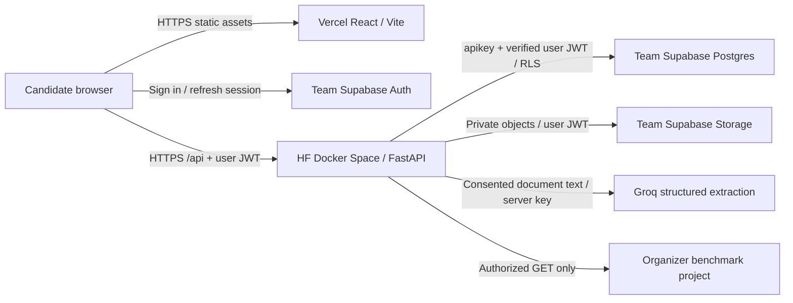

# RADIX ProofPath deployment plan

> Subsequent implementation update, 26 October 2026: Groq structured extraction and local
> deployment prerequisites are implemented; actual model/cloud execution remains pending.
> This document retains its earlier evidence/planning context. Current instructions and status:
> [DEPLOYMENT_SETUP.md](DEPLOYMENT_SETUP.md),
> [LLM_EXTRACTION_IMPLEMENTATION.md](LLM_EXTRACTION_IMPLEMENTATION.md),
> [LLM_EXTRACTION_EVALUATION.md](LLM_EXTRACTION_EVALUATION.md),
> [DEPLOYMENT_PREP_TEST_REPORT.md](DEPLOYMENT_PREP_TEST_REPORT.md).

Prepared 26 October 2026 (Asia/Kolkata). **Planning only: no application changes, account changes, provider calls, database migrations or deployments were performed.**

## 1. Scope and decision

Deploy the existing React/Vite frontend to Vercel, the Python/FastAPI backend to a Hugging Face Docker Space through the HF CLI, semantic extraction to Groq, and persistent application data to a team-owned Supabase project.

The attached “Close the Mandatory LLM Extraction Gap” prompt describes implementation work. The latest explicit request takes precedence: this document plans that work and deployment prerequisites; it does not execute them. LLM extraction in Modules 1 and 2 remains an acceptance gate. Hosting the existing rules parser does not close it.

Preserve all five root feature folders and their ownership: `jd_analytics`, `resume_parsing`, `profile_builder`, `talent_check`, `skill_matching`. Keep composition in `apps` and generic provider, storage, authentication and HTTP infrastructure in `shared`. No scoring-engine redesign is planned.

**Recommendation:** use a publicly reachable, authenticated API, CPU Basic initially, direct browser-to-HF API calls, Supabase Auth + Postgres + private Storage, and Groq structured extraction. Keep synthetic demonstration data explicitly separate from real benchmark mode. The architecture is suitable for a small hackathon deployment after the gates below; it is not currently ready to publish unchanged.

## 2. Findings from the existing repository

Repository root: your local checkout of this repository.

| Area | Actual implementation inspected | Deployment consequence |
| --- | --- | --- |
| Backend | [API composition](<apps/api/main.py>) exposes `/api/*`, composes all five modules, and supplies `/api/health` and `/api/status`. | Reuse `apps.api.main:app`; do not create a second backend. Health reports process availability; status flags only configuration presence, not successful dependency operations. |
| Frontend API | [API helper](<shared/ui/api.ts>) calls relative `/api`; [Vite configuration](<vite.config.ts>) proxies only during development. Evidence downloads and synthetic downloads also call relative `/api` directly. | A static Vercel build will not inherit the Vite proxy. Configure every API/download path, not just the central helper. |
| Authentication | [Backend identity](<shared/integrations/auth.py>) supports loopback-only local identity or Supabase `/auth/v1/user` verification. [App settings](<apps/web/App.tsx>) currently accept a manually pasted session token. | Add a real sign-in/session-refresh/sign-out flow before public multi-user use. Never enable shared local identity on HF. |
| JSON persistence | [Record store](<shared/integrations/store.py>) supports SQLite or Supabase REST with the user's JWT, owner filters and optimistic revisions. [Existing SQL](<scripts/supabase.sql>) defines the owner-scoped JSONB table and RLS policy. | Reuse the remote record adapter; apply reviewed, repeatable migrations only in a team-owned project, then test live RLS. |
| Documents | [Document infrastructure](<shared/integrations/documents.py>) stores original bytes as base64 inside JSON records. It limits uploads to 10 MiB, PDFs to 50 pages, text to 120,000 characters and expanded DOCX to 40 MiB. Seven-day deletion is access-triggered. | Private object Storage is a planned improvement, not an existing adapter. Base64 adds about 33% before JSON overhead and makes list/cleanup operations expensive. No background retention job exists. |
| LLM | [Hosted adapter](<shared/integrations/extraction.py>) supports configurable chat-completions URL/key/model; requests `json_object`, validates Pydantic output and exact quotes, and permits one repair. Feature services choose it only when hosted consent is true. | Groq wiring is feasible, but strict structured-output conversion, semantic evaluation, reliable fallback and live testing are unfinished. Existing HTTP failures return errors rather than automatically falling back. |
| Company standards | [Benchmark repository](<talent_check/backend/benchmark_repository.py>) performs GET requests to `staging_company_skill_levels`, validates 12 expectations, caches for 15 minutes, and can load a validated export. Synthetic mode is explicit. | Preserve read-only access and provenance. No organizer credentials, verified schema or genuine export are available. Real readiness remains unavailable until supplied. |
| Packaging | No Dockerfile, `.dockerignore`, Vercel deployment configuration or Git checkout exists here. | Prepare clean deployment bundles later. Do not upload the whole working directory or describe a nonexistent commit as a release. |

Read alongside [build plan](<docs/BUILD_PLAN.md>), the five module `PLAN.md` files, [traceability](<docs/REQUIREMENTS_TRACEABILITY.md>) and [limitations](<docs/FINAL_LIMITATIONS.md>). Some earlier completion language applies to local synthetic functionality; it does not establish LLM or cloud acceptance.

## 3. Target traffic and trust boundaries



Vercel serves the interface; it does not run the Python API or hold Groq credentials. The browser has its own short-lived Supabase session. HF verifies that session and forwards the user's identity to the application database and private files. Organizer benchmark access is separate from candidate storage, even if the organizer later permits both within one project.

Use direct HTTPS requests to the actual `*.hf.space` application hostname, not the `huggingface.co/spaces/...` repository page. This avoids routing document bodies and long extraction calls through Vercel Functions. CORS is browser policy, not authentication; callers can reach the API directly and must still pass JWT authorization and quotas.

## 4. Hugging Face: current requirements and CLI

### Hosting requirements checked

- **Creating Docker Spaces now requires a paid plan:** PRO for a personal account, Team/Enterprise for an organization. CPU Basic has no hourly charge and provides 2 vCPU, 16 GB RAM and 50 GB ephemeral disk. Do not promise a free-account Docker deployment. [Spaces overview](https://huggingface.co/docs/hub/spaces-overview).
- Put `sdk: docker` and `app_port: 7860` in the Space README YAML. Run the container as UID 1000 with writable owned directories and listen on `0.0.0.0:7860`. [Docker Spaces](https://huggingface.co/docs/hub/spaces-sdks-docker).
- Outbound HTTPS to Groq and Supabase is compatible with Spaces networking; do not depend on a direct Postgres connection over port 5432. [Spaces networking](https://huggingface.co/docs/hub/spaces-overview#networking).
- Local writes disappear on restart/stop. Current persistent-file guidance recommends attached Storage Buckets; this design instead keeps durable data in Supabase. Do not assume a persistent `/data` mount exists. [Spaces storage](https://huggingface.co/docs/hub/spaces-storage).
- CPU Basic sleeps after approximately 48 hours of inactivity. Upgrade hardware if an always-running demo is needed; paid membership alone does not remove Basic sleep. [Lifecycle and sleep](https://huggingface.co/docs/hub/spaces-gpus#set-a-custom-sleep-time).

Choose **public** source only if publication is acceptable, or **protected** visibility to hide source while keeping the application reachable. Protected is available on paid plans. A private Space is not a browser-accessible backend for arbitrary Vercel users; never embed an HF access token in the frontend to overcome that. [Visibility](https://huggingface.co/docs/hub/spaces-overview#creating-a-new-space), [repository settings](https://huggingface.co/docs/hub/repositories-settings).

### Local tooling finding

Read-only checks found global `huggingface_hub 0.36.2`. Its `hf upload` exists, but `hf repos create --help` and `hf spaces --help` fail because that version lacks the current command groups. No upgrade or login was performed. Docker was not found on PATH; a local Docker build is therefore not yet verified.

### Future CLI runbook — not executed

Use an isolated deployment environment; resolve and record a current compatible CLI version before authenticating. Python 3.10+ and virtual-environment installation are covered in the [HF installation guide](https://huggingface.co/docs/huggingface_hub/en/installation). Space/auth/upload commands below follow the current [HF CLI guide](https://huggingface.co/docs/huggingface_hub/en/guides/cli). The existing global executable must not accidentally shadow the upgraded one. Keep `.venv-deploy` excluded from any future source publication; the current ignore file only names `.venv`.

```powershell
Set-Location 'D:\Projects\26. jsssbootcamp'
py -3.10 -m venv .venv-deploy
.\.venv-deploy\Scripts\python.exe -m pip install --upgrade huggingface_hub
$hfTool = '.\.venv-deploy\Scripts\hf.exe'
& $hfTool version
& $hfTool repos create --help
& $hfTool spaces secrets add --help
& $hfTool auth login
& $hfTool auth whoami

$spaceId = 'YOUR_NAMESPACE/radix-proofpath-api'
& $hfTool repos create $spaceId --repo-type space --sdk docker --private
& $hfTool spaces secrets add $spaceId --secrets-file 'C:\PRIVATE\proofpath-hf-secrets.env'
& $hfTool spaces variables add $spaceId --env-file 'C:\PRIVATE\proofpath-hf-variables.env'
& $hfTool upload $spaceId 'D:\Projects\26. jsssbootcamp\deploy\hf-space-ready' . --repo-type space
& $hfTool spaces wait $spaceId --timeout 5m
& $hfTool spaces info $spaceId
```

Create private first; change visibility to the approved public/protected setting before Vercel integration. The staging folder and configuration files above do not exist yet. Only reviewed deployment files belong there. Keep credential files outside it; use the interactive login rather than a literal token in command history. Record the uploaded revision and inspect HF build/runtime logs. Subsequent uploads rebuild the Space; do not enable automatic recurring uploads.

### Future container packaging

Prepare a root Dockerfile and dedicated Space README in the staged backend bundle, without replacing the application README. Proposed metadata:

```yaml
---
title: RADIX ProofPath API
sdk: docker
app_port: 7860
---
```

Start with a pinned Python 3.10 slim image to match local Python 3.10.11; verify Linux compatibility and pin the image digest after a successful build. Install locked dependencies, then the project without editable development mode. The existing lock includes test/development libraries; prefer a separately validated runtime lock rather than silently changing dependency versions.

Use `COPY --chown` with explicit allowed folders, a nonroot user and a temporary directory such as `/tmp/proofpath`. Run:

```text
python -m uvicorn apps.api.main:app --host 0.0.0.0 --port 7860 --workers 1
```

Do not use reload, local SQLite, GPU/model-weight downloads, or embedded secrets. Include all five feature packages and generic shared code. Include only the clearly labelled synthetic benchmark file needed by explicit demo mode. Exclude `.env*`, private databases/CVs, original documents, real benchmark exports, release ZIPs, credentials, tests/results, `.venv*`, caches and `node_modules`. A `.dockerignore` is defense in depth; an allowlisted staging bundle prevents accidental HF repository publication too.

## 5. Vercel frontend and API integration

Configure the repository-root frontend with the Vite preset, install `npm ci`, build `npm run build`, output `dist`. Local Node is 24.16.0; select Vercel Node 24.x and verify the build. Installed Vite requires `^20.19.0 || >=22.12.0`. Preserve the bundled Inter font/license. [Vite on Vercel](https://vercel.com/docs/frameworks/frontend/vite), [supported Node versions](https://vercel.com/docs/functions/runtimes/node-js/node-js-versions).

**Required future changes:** introduce a generic API URL resolver using proposed `VITE_API_BASE_URL`, default `/api` for local development. Production value includes `/api`, e.g. `https://ACTUAL-SPACE-HOST.hf.space/api`. Resolve feature paths consistently without double `/api`. Apply it to the central API helper, evidence downloads and synthetic example downloads. Add bounded request cancellation and a useful cold-start/retry message. Do not automatically replay a potentially successful upload/save on a timeout.

Keep hash-based routes (`/#matching`, etc.); they already return to the root document. A catch-all SPA rewrite is only needed if path routes/auth callbacks are introduced. Any future `/api` rewrite must precede SPA fallback. Default plan uses direct HF calls, so no Vercel Python/serverless proxy is required.

Frontend Supabase integration should add sign-in, refresh and sign-out, then supply the current access JWT to API and download helpers. Remove manual token pasting from the public user flow. Use precreated test accounts or a controlled invite flow for the hackathon; do not open unrestricted registrations tied to paid inference immediately. Configure the exact production Site URL and needed auth redirect URLs in Supabase. [React Auth](https://supabase.com/docs/guides/auth/quickstarts/react), [redirect URLs](https://supabase.com/docs/guides/auth/redirect-urls).

Use one stable test frontend origin with isolated synthetic data. Do not allow every `*.vercel.app` origin. Vercel currently treats a new project's first deployment as Production, even from the CLI without `--prod`; provision test resources accordingly and do not assume that first URL is an isolated preview. Later preview builds need separately scoped values and explicit CORS origins. [Deployment environments](https://vercel.com/docs/deployments/environments).

## 6. Environment variables and secrets

Values below are placeholders, not supplied credentials. Marked **new** settings require future code changes. No account is connected or validated by this plan.

### Vercel build environment — public browser configuration only

| Name | Planned value | Status / exposure |
| --- | --- | --- |
| `VITE_API_BASE_URL` | `https://ACTUAL-SPACE-HOST.hf.space/api` | **New** API resolver; public. |
| `VITE_SUPABASE_URL` | Team-owned project's HTTPS URL | **New** Auth client; public. |
| `VITE_SUPABASE_PUBLISHABLE_KEY` | Team project's publishable key | **New** Auth client; public, protected by Auth/RLS rather than secrecy. |

Vite substitutes browser variables during build; changing them needs a fresh deployment. Groq keys, benchmark keys, service-role/secret keys, database passwords and HF tokens must never be `VITE_*` values. [Vite environment behavior](https://vite.dev/guide/env-and-mode), [Vercel variables](https://vercel.com/docs/environment-variables).

### HF runtime configuration

| Name | Planned value | Existing or planned |
| --- | --- | --- |
| `RADIX_AUTH_MODE` | `supabase` | Existing branch selection; explicitly validate permitted values in future startup checks. |
| `RADIX_STORAGE_MODE` | `supabase` | Existing remote JSON adapter; must never silently default to local in a cloud build. |
| `RADIX_ALLOWED_ORIGIN` | `https://YOUR-PROJECT.vercel.app` | Existing single exact origin, no trailing slash. |
| `RADIX_DATA_DIR` | `/tmp/proofpath` | Existing; scratch only, no durable candidate records. |
| `SUPABASE_URL` | Team application project URL | Existing. |
| `SUPABASE_ANON_KEY` | Team project's publishable key, subject to live header verification | Existing variable name is legacy; current app calls use it as `apikey`, with user JWT separately. Consider a clearer alias later. |
| `RADIX_LLM_URL` | `https://api.groq.com/openai/v1/chat/completions` | Existing; full endpoint, not only base URL. |
| `RADIX_LLM_MODEL` | Initially evaluate `openai/gpt-oss-20b` | Existing configurable model name; final selection depends on live results/access. |
| `RADIX_BENCHMARK_URL` | Organizer project's HTTPS URL, when authorized | Existing; separate from app project. |
| `RADIX_BENCHMARK_MAPPING` | Validated JSON mapping of actual columns | Existing; never guess schema/category dimensions. |
| `RADIX_BENCHMARK_FILTER` | Validated JSON PostgREST filters | Existing; restrict actual company/role/version scope. |
| `RADIX_BENCHMARK_EXPORT` | Unset initially | Existing; only use a genuine authorized snapshot with durable private retrieval and provenance. Never point it at a synthetic file. |
| `RADIX_DOCUMENT_STORAGE_MODE` | `supabase` | **Proposed new** private-file adapter selector; not implemented. |
| `RADIX_DOCUMENT_BUCKET` | `proofpath-documents` | **Proposed new** bucket setting; not implemented. |

### HF Secrets and deployment credentials

| Secret | Needed for | Handling |
| --- | --- | --- |
| `RADIX_LLM_API_KEY` | Groq API calls | Put the Groq key under this existing application variable. A `GROQ_API_KEY` alone is not currently read by the app. |
| `RADIX_BENCHMARK_KEY` | Authorized organizer reads | Store only server-side; require a read-limited mechanism. No normal candidate writes use it. |
| HF deploy token | Creating/updating the named Space | Deployment machine/secret manager only; fine-grained access for the target resource where supported. Initial creation also needs namespace permission. Not needed by the runtime app. |
| Vercel deploy authorization | Project setup/publication | Dashboard login or securely stored scoped token, only after deployment authorization. |
| Supabase migration authorization | Reviewed table/policy/bucket setup | Project dashboard or migration credentials, separate from runtime user access. Database password is not needed for normal REST requests. |

Supabase now distinguishes publishable/secret keys from legacy JWT `anon`/`service_role` keys. Privileged secret keys bypass RLS. Normal record requests must use the publishable key plus user JWT. The existing benchmark adapter puts the same key in both `apikey` and Bearer headers: **do not assume a new `sb_publishable_...` or `sb_secret_...` key is a JWT**. Review the organizer's grant/auth mechanism and adapt those headers before live acceptance. [Current Supabase key guidance](https://supabase.com/docs/guides/getting-started/api-keys).

For multiple origins, implement a new parsed exact-origin list and use it in both CORS middleware and mutation-origin validation; the current single setting is not comma-list aware. Until then use exactly one stable frontend origin per API deployment. Do not set undocumented LLM mode/timeout/quota variables and assume they work; add, document and test any such settings during implementation.

## 7. Supabase persistence, authentication and retention

1. **Separate app data from organizer data.** Create application tables/buckets only in an authorized team-owned project. Never apply the app SQL or writes to `staging_company_skill_levels`.
2. **JSONB records:** retain owner/kind/id/revision/payload/updated_at and optimistic concurrency. Make migrations repeatable; the current `create policy` statement will not safely rerun unchanged. Verify grants for authenticated users and no anonymous record access. RLS must enforce owner equality on insert, select, update and delete. A server-held privileged key is not a substitute for RLS. [RLS guidance](https://supabase.com/docs/guides/database/postgres/row-level-security).
3. **Private file bucket:** store originals under `<user-id>/<document-id>/<safe-file-name>`, private by default. Keep object path, hash, text sections and provenance in JSONB; do not expose permanent public URLs. Prefer the current authenticated API download route streaming private bytes using the user JWT. If short-lived signed URLs are introduced, treat them as bearer capabilities and avoid logging them. Owner-path policies must cover read/write/delete. [Storage access control](https://supabase.com/docs/guides/storage/security/access-control).
4. **Upload consistency:** validate before upload; create metadata only when object storage succeeds, or compensate for failures. Test retry/orphan recovery and deletion of both object and associated claims/receipts. Existing document cleanup must be adapted, not discarded. Synthetic public files may be packaged; existing private CV/history must not be migrated automatically.
5. **Retention:** preserve the seven-day policy unless the user changes it; show it accurately. Add a scheduled expiry process with the smallest privilege possible and bounded deletion, or keep the deployment restricted to synthetic test data until scheduled cleanup is ready. Access-triggered cleanup alone does not guarantee deletion seven days after upload. Document how backups and retained profile/receipt content are handled too.
6. **Backup/recovery:** choose project region and backup plan, export synthetic test records, restore into a test project, and verify object files separately. Postgres backups do not by themselves establish recoverability of file objects. Do not promise automatic backups on a free plan. [Supabase backups](https://supabase.com/docs/guides/platform/backups).

An authenticated, short-lived **synthetic-only pilot** could initially use the current base64-in-JSON remote adapter, with small fixture sizes and explicit disclosure. It would persist across Space restarts but would not mean private object Storage is implemented. The recommended public release uses the object adapter above; do not silently shrink or misrepresent the existing 10 MiB input limit to hide storage problems.

## 8. Groq extraction integration and acceptance

Use the existing HTTP adapter rather than replacing feature services. Groq's compatible API permits server-side requests to the endpoint above; no GPU is needed on HF. [Groq compatibility](https://console.groq.com/docs/openai).

Evaluate `openai/gpt-oss-20b` first, with `openai/gpt-oss-120b` as a separately evaluated alternative. Both are listed production models with structured-output support; final account availability must be checked through the authenticated Models API. They are proposals, not models already used by this application. [Models and prices](https://console.groq.com/docs/models).

Required implementation before claiming operational LLM extraction:

- Replace JSON-only formatting with a provider-compatible strict `json_schema` request where supported. Use a bounded extraction DTO rather than sending the whole persistence contract: the current `sections: list[dict[str, Any]]`, defaulted fields and server lifecycle fields need deliberate conversion. Strict schemas require all properties required and `additionalProperties: false`; nullable values can represent absent facts. Strict format does not guarantee factual correctness. [Structured outputs](https://console.groq.com/docs/structured-outputs).
- Keep JD semantic requirements/importance/relationships in Module 1 and resume fields/claims in Module 2. Support unfamiliar technologies, defensible implicit skills, negation and Python AND (PyTorch OR TensorFlow) without changing scoring semantics. If the flat group contract cannot express a case safely, use equivalent supported groups or explicit unresolved review; do not flatten it incorrectly.
- Keep server-generated identifiers, original source sections, mode/model/prompt provenance and lifecycle state under deterministic control. New proposals start needing review; never trust model-supplied reviewed status. Align evidence to actual source spans, including controlled whitespace normalization, and preserve the original quote.
- Validate schema, source type, category, references, quote alignment and conflicts. No numeric competency fields are model outputs. Imported profile ratings stay null until explicitly supplied.
- Keep an explicit per-input Groq consent choice; a configured API key is not consent. With no consent use rules locally on the backend. “Local” in a cloud deployment means processing on HF, not on the user's device; update misleading wording. No automatic third-party upload of the personal CV.
- Add bounded time/output/token budgets, a concurrency ceiling and authenticated per-user quotas. Handle 401/403, 429, 5xx, missing model, refusal, truncation, timeout and invalid JSON. Honor `Retry-After` within a total request deadline; avoid unbounded retries. Groq limits apply at organization level across requests and tokens, so a 20/minute IP limiter is insufficient. [Rate limits](https://console.groq.com/docs/rate-limits).
- Preserve input and return an honest rules-only/model-unavailable result when fallback is selected. A fallback must remain visibly different from an LLM-processed result and must not overwrite reviewed saved work. No tools, browsing or code execution are needed in extraction.

Groq receives consented extracted text, filenames if retained, source locations and the extraction schema/instructions; it does not need the original binary CV, stored profile history, benchmark keys or competency ratings. Minimize unnecessary contact data before sending where compatible with the extraction task. HF and Supabase also handle uploaded data. Review Groq Data Controls; inference retention has documented reliability/abuse exceptions, with ZDR available. Do not promise zero retention merely because ordinary inference is described as nonpersistent. [Groq data handling](https://console.groq.com/docs/your-data).

## 9. CORS and public-service security gates

- Set the exact HTTPS Vercel origin in `RADIX_ALLOWED_ORIGIN`. Allow GET/POST/PATCH/DELETE and preflight for `Authorization`, `Content-Type`, `X-ProofPath-Client`. Existing middleware handles these headers; verify actual OPTIONS behavior through HF. Expose `X-Request-ID` if the UI will read it. Bearer-header requests do not require cross-site cookies or `allow_credentials=true`.
- Preserve the custom client header on mutations, but do not treat it as a secret. Ensure errors raised by auth/origin/provider paths have safe JSON and usable CORS headers. Test localhost remains usable only in the separate local environment.
- Require `supabase` modes at cloud startup and fail closed on missing/invalid configuration. Verify authenticated endpoint ownership for profiles, documents, extractions and receipts. Never trust a client-supplied owner or unverified JWT decoding.
- Replace the current in-process, per-IP extraction limiter as the sole defense: HF proxies may collapse IPs, and restarts/workers reset counters. Use authenticated user quotas with a server-enforced shared counter, an overall Groq token/spend ceiling, and bounded concurrent extraction. Do not trust arbitrary forwarded IP headers.
- Enforce body limits before fully buffering large requests, bound PDF/DOCX parsing time/memory, and retain signature/ZIP/page/text checks. Test limits on the actual deployment, including 10 MiB uploads and cleanup after failures.
- Keep private files out of images, deployment bundles and browser assets. Redact Authorization headers, prompts, document text, payloads, signed URLs and provider responses from logs. Log request ID, operation, duration, provider/model and token counts with minimal identifiers.
- Configure HTTPS-only endpoints and frontend CSP/security headers with the actual HF/Supabase origins; avoid third-party analytics receiving sensitive page state. Escape document content through React; never render uploaded HTML directly. Scan built JavaScript, source maps and staged files for secrets.
- Protect or disable interactive API docs if unnecessary for the public demo; keep a minimal public liveness route. `/api/status` must not be represented as a deep readiness check or expose credentials. Live checks should be authenticated/admin-controlled and bounded, not paid model requests on every health probe.
- Keep schema/model errors reviewable and safely handle prompt injection. Evidence confidence stays separate from competency. Career GPS remains reversible and cannot save hypothetical skill gains into the actual profile.

## 10. Testing and release sequence

### Evidence already available, not rerun for this plan

[Final test report](<docs/FINAL_TEST_REPORT.md>) records 114 backend, 14 frontend and 14 full-suite browser tests, plus lint/type/build checks. Those are local results, not Linux-container, Groq, HF, Vercel or live Supabase verification. The existing Playwright configuration launches local servers; pointing its base URL at production alone is not an adequate deployed test suite.

### Execution order after implementation/deployment is authorized

1. **Prepare:** confirm account ownership, budget, source visibility, final hostnames and separate test resources. Create clean source manifests and a deployment-specific CLI environment. Preserve a copy of the current working release.
2. **Implement locally:** complete Groq extraction and fallback/status behavior, API URL resolution, Supabase Auth UI, private object storage, startup validation, CORS configuration and quotas. Preserve module boundaries and all review/scoring behavior.
3. **Run regressions:** from the repository root, run the commands below; use isolated synthetic test data. Record actual new outcomes rather than copying historic counts.

```powershell
.\.venv\Scripts\python.exe -m pytest -q
.\.venv\Scripts\python.exe -m ruff check .
.\.venv\Scripts\python.exe -m ruff format --check .
.\.venv\Scripts\python.exe -m mypy apps shared jd_analytics/backend resume_parsing/backend profile_builder/backend talent_check/backend skill_matching/backend --explicit-package-bases
npm ci
npm run test
npm run lint
npm run typecheck
npm run format:check
npm run build
npm run test:e2e
```

4. **Real-model gate:** use at least six independently labelled synthetic JDs and six resumes, including unfamiliar skills, implicit wording, AND/OR, negation, ambiguous inputs and injection text; PDF/DOCX variants count as formats, not additional independent sources. Compare rules versus actual Groq calls. Record raw TP/FP/FN, precision/recall, importance/group correctness, accepted-claim grounding, schema success, failures/fallbacks, tokens/cost and latency. Targets from the attached prompt are engineering targets: precision >=90%, recall >=85%, 100% provenance for accepted source claims, zero automatic ratings, no critical designated relationship errors. Current development-set rules metrics do not establish held-out or model performance.
5. **Supabase gate:** apply migrations only to the authorized test project. With users A and B, test CRUD/revisions across records and original files: B must not list/read/update/delete A's data, including direct REST/Storage requests. Test anonymous, expired and forged JWTs, sign-out clearing cached candidate state, database outage, partial upload, deletion and restore. Do not bypass RLS using a service key to make tests pass.
6. **Container gate:** build/run Linux image locally or in authorized CI; inspect image layers, UID, locked dependencies and empty scratch directory. Test health plus authenticated upload/review/profile/matching/scenarios at port 7860. No local Docker executable was available during planning, so this gate is open.
7. **Deploy test backend via HF CLI:** use the staged allowlist and secret files; inspect build/runtime logs and actual hostname. Verify `/api/health`, auth failures, Groq synthetic extraction and Supabase persistence. Restart/rebuild the Space and prove records/originals survive in Supabase. Test cold-start behavior and two concurrent users.
8. **Deploy test frontend on Vercel:** populate public build settings and exact backend origin; account for the first-deployment behavior above. Use a dedicated browser test configuration that does not start local servers. Verify desktop/mobile, sign-in/refresh, PDF/DOCX upload, pasted JD, source download, save/reload, all five modules, AND/OR explanation, what-if/reset and error states. Confirm browser requests reach HF rather than Vercel `/api` 404s. Test allowed/disallowed preflights and no secret values in browser traffic/assets.
9. **Benchmark gate:** when authorized organizer access arrives, inspect schema, mappings and 12 valid categories, verify only GETs occur, record source/hash/time, and run a real comparison. Until then demonstrate explicitly synthetic standards and an honest unavailable real-data state. This external gate cannot be passed with invented records.
10. **Promote and rehearse:** save matching frontend/backend release IDs, dependency locks, migrations and evaluation report. Publish only after deployment authorization and passing cloud/security gates. Run the synthetic Mira story end to end; live LLM results may differ from the saved rules baseline. Keep the labelled local/static fallback and exact interpretation of every displayed score.

### Rollback and operations

Retain the previous frontend deployment and last known-good HF source bundle/revision; promote/reupload the matching pair if necessary. Keep database changes additive and versioned; do not automatically undo migrations or erase user records during an application rollback. If Groq is unavailable, disclose rules fallback; if Supabase is unavailable, preserve drafts and return an error rather than writing ephemeral SQLite. Rotate compromised keys through provider controls and restart/redeploy only as necessary. Check health, dependency operations, errors, quota exhaustion and storage usage before each presentation. Warm the service deliberately before the demo; do not promise always-on behavior on Basic hardware.

## 11. Costs and budget controls

Checked against current official pages on 26 October 2026. USD estimates exclude tax, currency conversion, domains and unapproved upgrades; account eligibility/quotas must be confirmed before purchase.

| Service | Small demo choice | Cost / caveat |
| --- | --- | --- |
| Vercel | Hobby if the project qualifies as personal/noncommercial | $0 within limits. Team/commercial use may need Pro; current Pro platform fee is $20/month with one deploying seat, extra deploying seats $20/month and usage charges possible. [Hobby](https://vercel.com/docs/plans/hobby), [Pro](https://vercel.com/docs/plans/pro-plan). |
| HF Docker Space | Personal PRO + CPU Basic | PRO $9/month; Basic compute $0/hour. Optional CPU Upgrade $0.03/hour, about $21.90 for 730 running hours, in addition to membership. Organization pricing differs. No GPU is needed for Groq API calls. [HF pricing](https://huggingface.co/pricing). |
| Supabase | Free team application project for initial tests | $0, currently 500 MB database, 1 GB files and 5 GB uncached egress; pauses after a week of inactivity. Pro starts at $25/month; additional projects/overages can add cost. [Supabase pricing](https://supabase.com/pricing). |
| Groq | Account-accessible production model | Published per-million-token rates: GPT-OSS 20B $0.075 input / $0.30 output; GPT-OSS 120B $0.15 / $0.60. Verify account entitlement and billing; do not rely on an assumed unlimited free tier. [Model prices](https://console.groq.com/docs/models). |

Illustrative Groq calculation, not measured usage: 200 extraction calls × 5,000 input + 2,000 output tokens = 1 million input and 0.4 million output tokens. At the listed rates that is **$0.195 on 20B or $0.39 on 120B**, before repairs, chunking, repeated runs and other calls. Long schemas/documents may use substantially more. Measure actual usage in the evaluation.

A qualifying Hobby + personal HF PRO/Basic + Supabase Free setup therefore starts around **$9/month plus inference**, not $0. Vercel Pro and Supabase Pro together raise that base to about **$54/month plus inference/overages**. Optional always-on CPU Upgrade adds running-hour charges. Do not purchase any plan as part of this planning request.

Set provider spend limits/alerts and project quotas, reserve enough Groq request/token allowance for two simultaneous demos, cap input/output and retries, and check billing dashboards before the presentation. Store token totals without raw document text. A cost alert is not necessarily a hard spending stop; verify each provider's controls.

## 12. What the user must provide versus what Codex can prepare

| User/account owner supplies or decides | Codex can prepare after implementation authorization |
| --- | --- |
| Vercel account/team, project access, preferred project name and any domain/DNS ownership; applicable plan/budget. | Build settings, API URL integration, safe public environment template, headers, deployment manifest, browser checks and release instructions. |
| HF account/namespace with permission to create Docker Spaces and the required paid-plan eligibility; deploy token/login; public versus protected source choice; budget for any upgrade. | Isolated CLI setup, allowlisted backend bundle, Dockerfile/Space metadata, secret-name manifest, CLI deployment script, health checks and rollback artifacts. |
| Groq account/project API key, allowed model access, budget/rate limits and authorization for synthetic external tests. Separate explicit consent before sending the personal CV. | Provider schema integration, source validation, fallback/quotas, synthetic live-test harness and honest measured evaluation report once access is available. |
| Team-owned Supabase project URL/publishable key, permission for tables/RLS/private bucket/Auth settings, region and test accounts; dashboard/migration access through a secure mechanism. | Repeatable SQL/policies, Auth integration, object adapter, migration/restore instructions, two-user tests and environment validation. |
| Organizer-authorized read access or a genuine permitted export for `staging_company_skill_levels`, actual schema/filter scope, and permission to expose resulting expectations through the application. | Inspect/map/validate authorized data, configure the existing read-only repository and run real-data acceptance later. No invented expectations or organizer-table writes. |
| A later explicit instruction to implement and deploy/publish, including any spending choices. | Complete approved local prerequisites and present the tested bundle/configuration before external deployment. This request authorizes only this plan. |

Provide secrets through platform secret settings or a private local configuration file, not pasted into chat or committed to a repository. CLI-based Vercel deployment can avoid requiring a Git provider account; Git integration is optional future automation. HF CLI can upload the allowlisted folder without initializing Git in the current workspace.

Missing organizer resources do not prevent preparing the Groq, container, Auth, storage and frontend changes. They do prevent claiming official benchmark acceptance. Missing account credentials prevent live cloud/provider verification, not local preparation.

## 13. Planning verification and remaining gates

Actually performed for this plan: inspected repository contracts/services/configuration, all five module plans, SQL and test documentation; read the attached prompt as context; checked official HF/Vercel/Groq/Supabase documentation; inspected local Node/npm/Python versions; ran read-only HF version/help commands. Installed HF `0.36.2` lacks the documented modern command groups. Docker availability was not established on PATH.

Not performed: CLI installation/upgrade, login/account inspection, Groq inference, Supabase queries/migrations, Docker build, application test reruns, Vercel/HF deployment, private-document upload, or billing changes. Existing test counts above are explicitly historical.

Before a public release, close the live LLM, cloud authentication/owner isolation, durable-file persistence, CORS/API routing, quota/secret protection and deployed browser-test gates. Keep original-pack/official benchmark acceptance visibly pending until the organizer supplies authorized material. All five modules remain intact.

